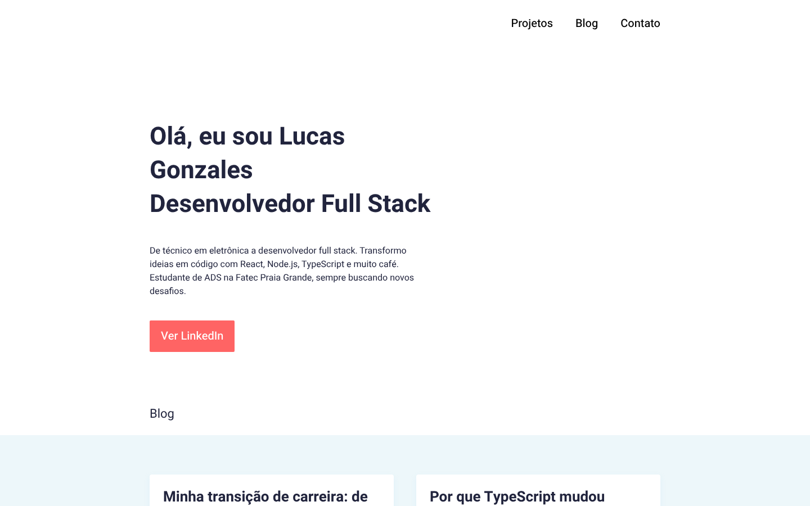

# Portfólio em React

  

Portfólio pessoal de página única, com navegação que acompanha a rolagem e animação de entrada nas seções. Feito com React e hooks, sem biblioteca de animação.

Desafio de React Hooks da formação **Engenheiro de Software (Escola DNC)**, entregue e aprovado na avaliação do projeto.

<p align="center">
  
</p>

## Como funciona

- **Scroll spy no menu.** O `Header` escuta a rolagem e compara a posição com o topo e a altura de cada seção (`offsetTop` / `offsetHeight`). O link da seção visível fica ativo.
- **Animação de entrada.** Seções marcadas com `.animate-on-scroll` são checadas com `getBoundingClientRect()`. Quando entram em 85% da altura da tela, recebem a animação.
- **Listeners com limpeza.** Todo `addEventListener` criado no `useEffect` é removido no retorno do efeito, para não acumular listeners quando o componente desmonta.
- **Um componente por seção** (Header, Hero, Blog, Projects, Footer), cada um com o próprio CSS.

## O que aprendi

- O ciclo de vida com `useEffect`: quando o efeito roda, por que o array de dependências vazio e por que limpar o que foi registrado
- Ler posição de elementos no DOM a partir do React sem brigar com a renderização
- Quebrar uma página em componentes com responsabilidade clara

## Rodando

```bash
git clone https://github.com/lucas-gonzales-dev/portfolio-react.git
cd portfolio-react
npm install
npm run dev     # http://localhost:5173
```

## O que eu faria diferente hoje

- Trocar o listener de scroll por `IntersectionObserver`, que avisa quando a seção entra na tela sem recalcular posição a cada pixel rolado
- Respeitar `prefers-reduced-motion` para quem desativa animações no sistema

---

Feito por **Lucas Leite Gonzales** · [LinkedIn](https://www.linkedin.com/in/lucas-leite-gonzales-dev/)
